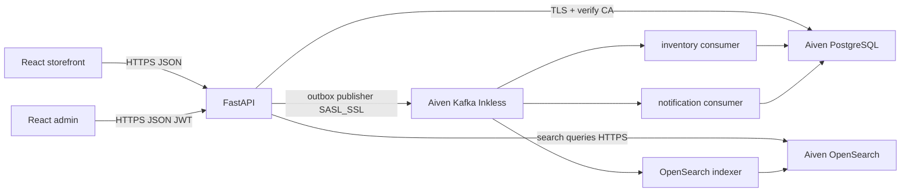

# SHOPNOVA architecture

SHOPNOVA is a production-minded e-commerce platform for Indian retail. PostgreSQL is the source of truth, Apache Kafka carries domain events, and OpenSearch powers customer search.

## Why all three services are required

| Service | Role | Why it cannot be replaced by the others |
|---|---|---|
| **Aiven PostgreSQL** (`pg-39f21b1d`) | Orders, inventory, carts, users, outbox | Inventory must be reserved atomically under row-level locking. Kafka cannot enforce stock. Search indexes are eventually consistent copies. |
| **Aiven Apache Kafka Inkless** (`kafka-12572b23`) | Reliable fan-out of committed business events | Decouples order placement from search indexing and notifications. Survives consumer downtime via the transactional outbox. |
| **Aiven OpenSearch** (`os-114c34a2`) | Typo-tolerant product discovery | Full-text, fuzzy and filtered search at query time. PostgreSQL `LIKE` cannot provide ranked fuzzy matching for the customer experience. |

## High-level flow

## Order placement (authoritative path)

1. FastAPI validates the customer, cart, address and payment method.
2. A PostgreSQL transaction:
   - atomically decrements `inventory.available_quantity` only when stock is sufficient
   - creates `orders` and `order_items`
   - writes `inventory_transactions`
   - inserts `outbox_events`
3. The HTTP response is success **only** after that commit.
4. A separate outbox publisher reads unpublished rows and produces to Kafka.
5. Consumers process events **idempotently** (`processed_events`).
6. The indexer updates OpenSearch availability. Stale events cannot overwrite newer versions.

## Kafka Inkless compatibility (design constraints)

Inspected against Aiven Diskless/Inkless documentation:

**Supported and used**

- Produce and fetch
- Consumer groups
- Offset commit via the group coordinator
- SASL_SSL (SCRAM-SHA-256 / PLAIN)
- Topic ACLs
- Idempotent produce (enabled where the broker allows it)

**Not used (unsupported or unsafe on diskless topics)**

- Kafka transactions (`enable_idempotence` + transactional IDs spanning produce)
- Compacted topics
- `read_committed` isolation against diskless topics
- Kafka Streams state stores

**Implication:** exactly-once across services is implemented with the **PostgreSQL transactional outbox + consumer idempotency keys**, not Kafka transactions.

Topics (logical names; prefix configurable):

- `shopnova.order-events`
- `shopnova.inventory-events`
- `shopnova.product-events`
- `shopnova.notification-events`
- `shopnova.dead-letter-events`

Topic creation on Free-plan Aiven Kafka is often restricted. The verification script checks whether the application user can create topics; otherwise they must be created in the Aiven console.

## OpenSearch

Index: `shopnova-products`

Mapping uses a multi-field analyzer (standard + edge n-gram for autocomplete) and `fuzziness: AUTO` on name/brand queries so `"bluetoth hedphones"` still matches Bluetooth headphones.

Documents are versioned with `updated_at` (epoch millis) as `if_seq_no` alternative via external version or a stored `source_updated_at` guard in the indexer.

## Process topology

| Process | Responsibility |
|---|---|
| `uvicorn app.main:app` | HTTP API |
| `python -m consumers.outbox_publisher` | Publish committed outbox rows |
| `python -m consumers.inventory_consumer` | Inventory history, idempotent |
| `python -m consumers.search_indexer` | OpenSearch sync |
| `python -m consumers.notification_consumer` | Order confirmation records |

## Trust boundaries

- The browser never receives Aiven credentials.
- Admin APIs require `role=ADMIN`.
- Customers can only read their own carts, addresses and orders.
- TLS with CA verification is required for PostgreSQL, Kafka and OpenSearch.
